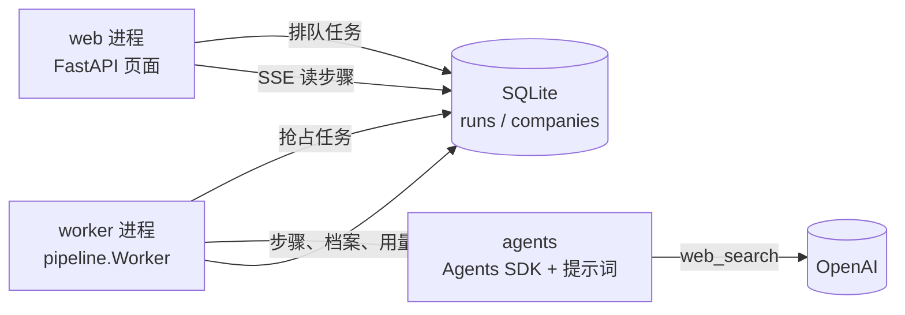

# 架构

这份文档给第一次读代码的人一张地图：系统做什么、代码在哪、哪些规则不能破。业务背景见 [docs/01-方案总览.md](docs/01-方案总览.md)。

## 一张图



- web 进程只做两件事：把用户的操作变成数据库里排队的任务，和展示结果。它不调用模型。
- worker 进程从数据库抢占任务，按固定流程调用 agent，把每一步写回数据库。
- 两个进程只通过数据库通信。SQLite 开 WAL，单机足够；以后多客户再换 Postgres。

业务流程（代码编排，不是 agent 之间互相移交）：

```
寻客 agent → 按域名去重（代码）→ 调研 agent（每家一个干净上下文，并行）→ 审查 agent（不通过最多返工一次）
→ 今日审核（每天最多 10 张）→ 人工决定 → 文案 agent → 业务员从企业邮箱手动发送
```

## 代码地图

```text
prompts/                 提示词契约。运营可以改，第一行是版本号
knowledge/               知识包。core/ 常驻，markets/ 按国家加载，writing.md 只给文案
src/workbench/
  agents/                和模型打交道的一切
    schemas.py           4 个 agent 的交卷格式（Pydantic，严格 JSON Schema）
    prompts.py           把契约和知识包按固定顺序拼成系统提示，算版本号
    runner.py            Agents SDK 薄封装 SdkRunner；测试用 ScriptedRunner
  pipeline/              业务流程，入口是 Workbench（__init__.py）
    context.py           公共依赖、运行记录、call_agent（拼提示词 → 调 agent → 记步骤和用量）
    prospect.py          寻客、去重、每日上限
    research.py          调研 + 审查 + 最多一次返工
    review.py            今日审核队列、人工决定
    outreach.py          文案、草稿、联系记录、RFQ、拒绝联系
    worker.py            抢占和执行排队任务、重启恢复
  store/                 数据库：models.py 表结构，db.py 连接与备份，queries.py 共用查询，migrations/
  web/                   页面：app.py 组装，routes/ 按页面拆分，view.py 展示逻辑，templates/，static/
  catalog.py             导入冠维样册、确认首推 SKU
  evals.py               评测集、LLM 评委、基线名单对比
  demo.py                载入演示数据
  normalize.py           域名、公司名、国家标准化
  sanctions.py           制裁名单名称比对（只做提示）
  cli.py                 workbench 命令
tests/                   与 src 对应：pipeline/、web/，factories.py 是 agent 交卷样例
seed/                    冠维样册数据库、演示档案
eval/                    评测集、反例、基线名单、报告
```

从哪里开始读：`prompts/researcher.md` → `agents/schemas.py` → `pipeline/research.py` → `pipeline/context.py`。

## 不变量

这些规则在任何改动后都必须成立，大多数有测试守着：

1. **系统不发邮件。** 代码里没有任何发信逻辑。草稿只能复制，"已发送"是业务员手动登记。（`pipeline/outreach.py`）
2. **拒绝联系的公司不会再出现。** 拒绝联系名单交给寻客 agent，去重时代码再剔除一遍；名单里的公司不能重新调研。（`tests/pipeline/test_prospect.py`、`test_research.py`）
3. **花费有上限。** 每次 agent 调用有 `max_turns`，每天新增候选有上限，每次调用的 token、搜索次数和 trace id 都记在 `runs.agent_calls`。
4. **审查最多返工一次。** 调研 → 审查 → 返工 → 复查，之后无论结果都交给人。（`test_review_allows_at_most_one_revision`）
5. **agent 之间不传网页原文。** 每家公司的调研是干净上下文，审查 agent 只看档案。
6. **代码不校验 agent 的结论。** 质量靠提示词契约和审查 agent；代码只负责去重、排队、记账和以上底线。评测（`evals.py`）是测量，不是生产流程里的拦截。
7. **一张卡只能决定一次。** 重复点"接受"不会排两个文案任务。（`test_decide_twice_is_rejected`）

## 横切关注点

- **提示词版本**：系统提示 = 契约 + 知识包 + 已确认 SKU + 国家说明，内容一变版本号就变。每次调用记下版本号，评测报告按版本对比。
- **时间**："今天"按工厂所在时区（`WB_TIMEZONE`，默认 Asia/Shanghai）计算；`Workbench` 接受注入的时钟，测试用固定时间。
- **测试**：全部用 `ScriptedRunner` 代替真实模型，不联网，几秒跑完。真实效果用 `workbench eval run` 在评测集上测。
- **迁移**：改了 `store/models.py` 就 `uv run alembic revision --autogenerate -m 说明`，启动时自动升级到最新。
- **前端**：服务端渲染 + htmx，无构建步骤。设计令牌在 `web/static/css/app.css` 顶部；评分构成条是全站唯一的强调元素。
