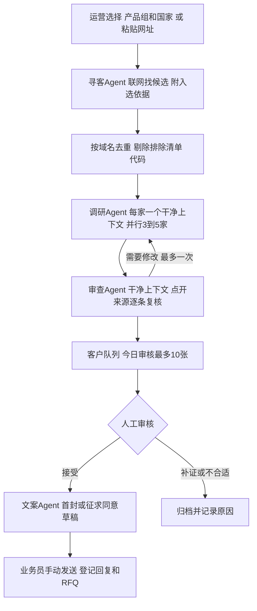

# 冠维获客工作台 v2：方案总览

> 适用对象：邯郸冠维紧固件（永年）。单客户托管部署。本文是精简版方案的落地说明，代码在 `src/workbench/`。

## 1. 一句话

每天给业务员**最多 10 张查实过的海外批发商卡片**，每张附首封草稿和联系路线建议。联系谁由人决定，邮件由人手动发出，系统负责记录回复和询价（RFQ）。

核心原则是"先查实、再出手"：AI 给出的名单只当线索，每家公司都要经过调研和审查，有来源才进卡片。

## 2. 业务流程

1. **产品先行**：工厂从 84 张产品卡里确认 10 个首推 SKU（材质、规格、表面处理、起订量）。确认后的规格进入知识包，文案只引用这些 SKU。
2. **寻客**：运营选"产品组 + 国家"，或直接粘贴几个网址。寻客 agent 联网找候选，每家写明满足了哪 1-3 条条件，并附来源。
3. **去重**（代码）：按域名去重，剔除拒绝联系名单、已处理公司和目录站。
4. **调研**：每家公司开一个干净上下文，3-5 家并行。调研 agent 交一份客户档案，每个字段都附来源，查不到就写"未找到"。
5. **审查**：审查 agent 不看调研过程，只看档案，点开引用的来源逐条核对。不通过就退回调研 agent 修改，最多一次。
6. **今日审核**：每天最多 10 张卡进入审核。业务员可以接受、要求补证，或标记不合适并写原因。
7. **写信**：业务员接受后，文案 agent 才写首封邮件（南非写征求同意信），中英对照。
8. **手动发送与跟进**：业务员把草稿复制到企业邮箱发出，回系统点"已发送"，之后登记回复和 RFQ。
9. **报价**：从 RFQ 开报价单，可以多行。价格、交期由人和工厂确认后填写，系统只算合计和毛利（成本只在系统里看，不打印）。打印成英文报价单 PDF，从 WhatsApp 或邮件发出，回来登记"已发给客户"。发出的版本锁定，改价出新版本，对方接受或不接受都记下来。

## 3. 两级队列

由调研 agent 按提示词里的口径判定，代码不再二次打分。

| 队列 | 判定口径 | 用途 |
| --- | --- | --- |
| 可首触 | 产品族对得上，且有公开联系入口（官网邮箱、询价表单、供应商注册入口） | 进入今日审核，可以发首封 |
| 合格买家 | 25/35/15/15/10 口径：身份真实 25、产品匹配 35、采购信号 15、可联系性 15、风险 10，总分 ≥ 70 且无红线 | 通常在对方回复后才达到；优先跟进、报价 |
| 不合适 | 制造商同行、零售终端、反倾销申诉方、受制裁或无法确认身份 | 归档，写明原因 |

联系前，"合格买家"的大部分证据（采购量、现有供应商）一般拿不到，所以首触门槛只要求"对得上、联系得上"，不要求"确认是买家"。

## 4. 联系渠道：邮件开门，WhatsApp 成交，系统不代发

- 首次联系用邮件，从公司**自有域名**的企业邮箱手动发出，每天约 10 封，不用免费邮箱。
- 邮件签名附 WhatsApp 号码或 `wa.me` 链接，让对方主动加。对方回复或主动加 WhatsApp 后，打样、报价、发图都转到 WhatsApp 上谈。第一版用 WhatsApp Business App 手机端，不接 API。
- 不用 WhatsApp 做第一次联系。WhatsApp 商业政策要求对方事先同意，官网挂的号码是给客户咨询用的，不算同意接收供应商推销。
- LinkedIn 和电话只由人工操作，作为补充渠道。
- 各国差异见 [02-市场与合规.md](02-市场与合规.md)：阿联酋可以直接发首封；南非首封只能征求同意；沙特先走供应商注册、LinkedIn 或电话。

## 5. Agent 编排

| Agent | 工具 | 输入 | 交卷 |
| --- | --- | --- | --- |
| 寻客 | WebSearch | 产品组、国家、排除清单 | 候选列表：公司名、官网、国家、满足的条件、来源 |
| 调研 | WebSearch | 一家候选 + 已确认 SKU 摘要 + 该国市场说明 | 客户档案：身份、采购角色、产品对应、联系入口、采购信号、风险、缺项；评分理由、队列、联系路线 |
| 审查 | WebSearch | 只有档案 | 通过，或需修改并附修改意见 |
| 文案 | 无 | 档案 + 已确认 SKU + 写作规范 | 首封邮件或南非征求同意信（中英对照） |

为什么只用 4 个 agent，而且由代码编排：

- OpenAI 的实践指南和 Agents SDK 文档都建议先把单个 agent 用足，主流程用代码编排，这样速度、成本和效果更可预测。
- 并行只用在"读"的环节（寻客、调研）。审查用干净上下文，避免同一个 agent 自己给自己打分。
- 原来的评估 agent 并入调研 agent。回复分诊和助手对话不进第一版。

## 6. 答案效果靠设计保证

本版不在代码层校验 agent 的结论，效果全部靠下面几项设计：

1. **提示词写成契约**：每份按"角色、目标、输入、步骤、交卷字段、质量要求、好坏示例"写，并明确三点：要看哪些页面；每个字段都附来源；允许写"未找到"，不推测邮箱和人名。提示词在 `prompts/`。
2. **分层知识包**：系统提示只常驻核心摘要（我方产品、目标客户、评分口径），国家细节按任务加载，前缀保持稳定以便命中缓存。知识包在 `knowledge/`。
3. **每家公司一个干净上下文**：子任务只返回结构化档案，不在 agent 之间传网页原文。
4. **审查 agent**：点开来源核对，重点查编造的邮箱或人名、同名公司混淆、结论和来源对不上。
5. **模型策略**：先全部用最强模型加高推理档建立基线，评测集稳定后，再逐个环节试降到便宜模型。型号都写在配置里，代码不写死。
6. **迭代闭环**：每次运行记录 trace id 和提示词版本。每周挑出被驳回的卡片，打开 trace 找原因，改提示词，再在评测集上前后各跑一次对比。

## 7. 三条安全底线

1. **不自动发送**：系统里没有发信代码，草稿只能复制。
2. **排除清单**：拒绝联系和已处理的公司作为排除清单交给寻客 agent，去重时代码再剔一遍。
3. **花费上限**：每次运行设 `max_turns`，每日候选数设上限，每次运行都记录 token 和搜索次数。

## 8. 技术选型

- 后端：Python 3.12、FastAPI、SQLAlchemy 2 + Alembic、`openai-agents==0.23.1`（锁定版本，SDK 仍是 0.x）。
- 只用 SDK 的 `Agent`、`Runner`、`output_type`、托管 `WebSearchTool` 和 tracing。任务状态存在自己的数据库里，不用 SDK 的 Session。
- 前端：服务端页面（Jinja + HTMX），用 SSE 推送 agent 实时步骤。视觉取自镀锌钢件的冷灰蓝，信息按"结论 → 依据 → 来源"分层，今日审核支持键盘操作。
- 数据库：SQLite（WAL 模式）。以后多客户时再换 Postgres。
- 部署：新加坡 VPS，Docker Compose 跑 web、worker、caddy，每日备份。

## 9. 里程碑（工期为估算）

- **M0 演示版，约 1.5-2 周**：产品库导入与 SKU 确认；4 个 agent 与工作流；运行实时步骤、客户档案、今日审核、草稿；评测集基线；用真实数据跑出 15-20 张客户卡，与"直接问 ChatGPT 的名单"并排对比。
- **M1 试点 30 天**：联系记录与 RFQ、报价单（版本可追溯）、登录、部署；每周复盘一次提示词。
- **M2 按问题再加**：回复分诊、助手对话、引用链接可打开检查等代码校验、合规确认后的邮件发送；TikTok 评论询盘（官方接口读自己视频的评论，见 [05-规划功能.md](05-规划功能.md)）。

## 10. 待工厂确认的事项

- 10 个首推 SKU 的规格、表面处理、起订量和交期。
- 是否有自有域名企业邮箱（例如 `sales@guanwei…`），以及 WhatsApp Business 号码。
- 出口资质与常用贸易术语（FOB 天津 / CIF），能否出具材质证书和检测报告。
- 是否接受贴牌、OEM 包装（阿联酋几家客户有自有品牌，审查时发现调研 agent 会主动提这一点）。
- 试点国家的先后：建议阿联酋先行，南非同步做征求同意，沙特放第二阶段。
