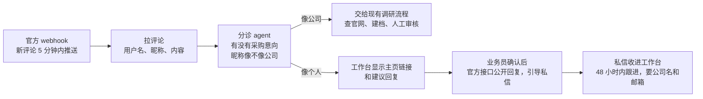

# 规划功能

这里记录已经调研过、决定要做但还没实现的功能。每项写清楚做什么、不做什么、前提条件和依据，动手前先读这一页。

## TikTok 评论询盘（规划中，未实现）

网页侧栏已有"TikTok 询盘"入口（`web/routes/tiktok.py`、`pages/tiktok.html`），目前只展示收件箱的样子和接入前要准备的事项，后端未接入。

### 做什么

冠维开 TikTok 企业号发产品视频。系统通过 TikTok 官方接口读取**自己视频下的评论**和 **@ 冠维的评论**，找出有采购意向的留言，交给业务员跟进。

1. **评论收件箱**：webhook 推送新评论，系统拉取评论内容和评论者的用户名、昵称。
2. **分诊**：一个 agent 判断留言有没有采购意向（问价格、起订量、规格、要联系方式），以及昵称像不像公司名。
3. **像公司的，自动调研**：例如昵称 "Gulf Fasteners Trading"，把公司名交给现有调研流程查官网、建档、进今日审核。查的是公司公开信息，不碰 TikTok 主页。
4. **像个人的，人工处理**：工作台显示"打开主页"链接（用用户名拼出），业务员自己点开看；系统给一条回复建议，业务员确认后通过官方接口公开回复，请对方私信。
5. **私信跟进**：对方私信后，消息接口把对话收进工作台，业务员在私信里要公司名和邮箱，再走现有的跟进和询价流程。

### 不做什么

- **不抓评论者主页**。官方评论接口只返回用户名、昵称、头像，不返回简介、主页链接和联系方式；自动打开主页抓取就是爬虫，违反 TikTok 服务条款，被封的是冠维自己的企业号。
- **不抓别人视频的评论区**（包括竞品）。开源爬虫（TikTok-Api、TTScraper 等）都靠登录账号截获内部接口，条款明令禁止，而且经常被反爬卡住。
- **不反查个人身份**。昵称是个人名字的，不去搜索他是谁、在哪家公司。这和知识包的规则一致：不搜索、不记录个人社交账号和私人联系方式。
- **不主动私信**。官方接口也不允许：只能回复对方先发来的私信。

### 前提条件

- 冠维注册 TikTok 企业号，绑定 TikTok for Business 或 Business Center。
- 在 TikTok API for Business 开发者后台建应用，申请评论管理和私信权限（`comment.list.manage` 等），企业号授权给应用。
- 私信设置为"所有人可发"，否则消息要在手机上手动接受。
- **网络**：TikTok 在国内打不开。webhook 回调地址和接口调用要放在能访问 TikTok 的海外服务器上，或单独做一个海外中转。
- 账号注册地：私信接口目前对亚太、拉美、中东非洲、北美开放；注册地在欧盟、英国的不能用。

### 接口和限制

| 能力 | 接口 | 限制 |
| --- | --- | --- |
| 读自己视频的评论 | `GET /business/comment/list/` | 只能读自己账号的视频；每页最多 30 条；返回评论者 `username`、`display_name`、临时头像链接 |
| 新评论推送 | COMMENT webhook | 5 分钟内送达 |
| 读 @ 冠维的评论 | `/business/mention/comment/list/` | 只限提到品牌账号的评论 |
| 公开回复评论 | comment reply 接口 | 由业务员确认后发出 |
| 私信 | Business Messaging API | 只能回复对方先发的私信；对方最后一条消息后 48 小时内最多 10 条；每天约 100-200 个对话 |
| 评论直接转私信 | Comment-to-Message | 目前只开放给越南、印尼、泰国注册的账号，冠维用不了 |

### 为什么这样设计

- **合规**：只处理对方在冠维自己视频下的公开留言，联系方式由对方在私信里主动给出。GDPR、阿联酋 PDPL、南非 POPIA 都把评论者信息视为个人信息，"公开可见"不等于可以拿来营销。
- **找得准**：B2B 批发商很少在评论区留言；留言的多是个人、小工程队和同行。所以只把"像公司"的留言送进调研，个人留言只在工作台提示，不进客户队列。
- **复用现有流程**：分诊之后接的是现有的调研、审核、跟进和询价，新增的只有评论收件箱、分诊 agent 和私信收件箱。

### 依据

- TikTok API for Business：[管理自有视频评论](https://business-api.tiktok.com/portal/docs/manage-comments-on-owned-tiktok-videos/v1.3)、[Business Messaging API](https://business-api.tiktok.com/portal/docs/business-messaging-api/v1.3)、[Comment-to-Message](https://business-api.tiktok.com/portal/docs/enable-or-disable-comment-to-message-for-a-business-account/v1.3)
- Research API 能查任意公开用户的简介，但只开放给学术机构、禁止商用：[Query User Info](https://developers.tiktok.com/doc/research-api-specs-query-user-info)
- 开源爬虫现状：[davidteather/TikTok-Api](https://github.com/davidteather/TikTok-Api) 抓评论被识别为机器人的问题未解决（[#1255](https://github.com/davidteather/tiktok-api/issues/1255)）；[MediaCrawler](https://github.com/NanmiCoder/MediaCrawler) 只支持抖音，协议禁止商用。
